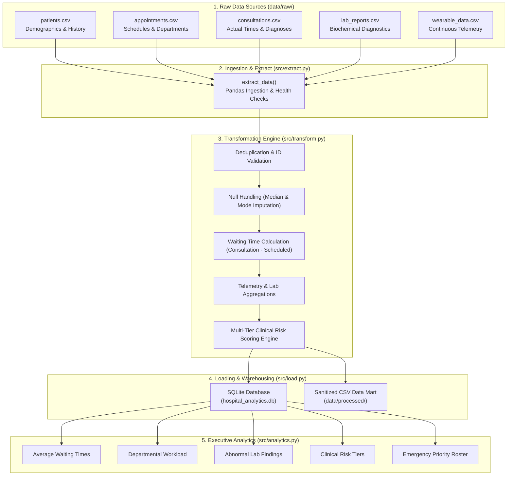

# 🏥 Hospital Patient Care Analytics System
### End-to-End ETL (Extract, Transform, Load) Pipeline & Clinical Intelligence Platform

A modular, production-ready, and beginner-friendly Data Engineering pipeline designed for a multi-specialty hospital. The system collects, cleans, transforms, stores, and analyzes patient data from five disconnected clinical systems to reduce outpatient waiting times and prioritize high-risk patients.

Built using **Python**, **Pandas**, **SQLite**, and **SQL**, this project extends the foundational data cleaning and manipulation techniques introduced in `ETLPipeline.ipynb` into a full-scale healthcare data engineering architecture.

---

## 📌 Table of Contents
1. [Architecture & Workflow](#-architecture--workflow)
2. [Project Folder Structure](#-project-folder-structure)
3. [Source Datasets (Data Dictionary)](#-source-datasets-data-dictionary)
4. [Data Transformations & Cleansing](#-data-transformations--cleansing)
5. [Clinical Risk Scoring Rules & Thresholds](#-clinical-risk-scoring-rules--thresholds)
6. [Database Schema (SQLite)](#-database-schema-sqlite)
7. [Analytical KPIs & SQL Queries](#-analytical-kpis--sql-queries)
8. [How to Run the Pipeline Locally](#-how-to-run-the-pipeline-locally)
9. [Sample Pipeline Execution Output](#-sample-pipeline-execution-output)
10. [Student Presentation & Interview Guide](#-student-presentation--interview-guide)

---

## 🏗 Architecture & Workflow

The pipeline strictly adheres to the standard Data Engineering lifecycle: **Extract $\to$ Transform $\to$ Load $\to$ Analyze**.



---

## 📂 Project Folder Structure

```
usecase datapipeline/
│
├── data/
│   ├── raw/                                # Raw source CSV files
│   │   ├── patients.csv                    # Patient registration records
│   │   ├── appointments.csv                # Appointment bookings
│   │   ├── consultations.csv               # Doctor consultations and notes
│   │   ├── lab_reports.csv                 # Lab test results and reference ranges
│   │   └── wearable_data.csv               # Continuous IoT vital sign telemetry
│   │
│   └── processed/                          # Cleaned, standardized, sanitized CSVs
│       ├── cleaned_patients.csv
│       ├── cleaned_appointments.csv
│       ├── cleaned_consultations.csv
│       ├── cleaned_lab_reports.csv
│       ├── cleaned_wearable_data.csv
│       └── patient_health_summary.csv      # Analytical master view
│
├── database/
│   └── hospital_analytics.db              # SQLite relational data warehouse
│
├── sql/
│   ├── create_tables.sql                   # DDL scripts with primary/foreign keys & indexes
│   └── analytics_queries.sql               # Executive SQL queries for KPIs
│
├── src/
│   ├── __init__.py                         # Python package initializer
│   ├── extract.py                          # Ingestion & file validation module
│   ├── transform.py                        # Cleaning, waiting time, & clinical scoring engine
│   ├── load.py                             # SQLite & CSV warehouse loading module
│   └── analytics.py                        # SQL KPI execution & executive report generator
│
├── pipeline.py                             # Main CLI pipeline orchestrator
├── Hospital_ETL_Walkthrough.ipynb          # Step-by-step interactive Jupyter notebook
└── README.md                               # Complete project documentation & guide
```

---

## 📋 Source Datasets (Data Dictionary)

| Dataset | Primary Key | Description | Key Attributes |
| :--- | :--- | :--- | :--- |
| **`patients.csv`** | `patient_id` | Patient registration & demographic profiles | `first_name`, `last_name`, `gender`, `date_of_birth`, `phone`, `chronic_condition` |
| **`appointments.csv`** | `appointment_id` | Scheduled clinic appointments | `patient_id`, `appointment_date`, `scheduled_time`, `department`, `doctor_id`, `status` |
| **`consultations.csv`** | `consultation_id` | Completed physician consultations | `appointment_id`, `patient_id`, `consultation_time`, `diagnosis`, `treatment_notes` |
| **`lab_reports.csv`** | `lab_id` | Laboratory biochemical tests | `patient_id`, `test_name`, `test_value`, `reference_min`, `reference_max`, `test_unit` |
| **`wearable_data.csv`** | Composite | High-frequency IoT biometric vitals | `device_id`, `patient_id`, `timestamp`, `heart_rate`, `systolic_bp`, `diastolic_bp`, `spo2`, `daily_steps` |

---

## ⚙️ Data Transformations & Cleansing

The transformation phase adapts and extends the core pandas methodologies demonstrated in `ETLPipeline.ipynb`:

1. **Deduplication:** Full duplicates across all datasets are detected and eliminated using `.drop_duplicates()`.
2. **Missing Value Imputation:**
   - **Numerical Imputation:** Missing continuous telemetry readings (such as `spo2` and `daily_steps`) and missing ages are imputed using the **median** of the respective distribution:
     ```python
     df['spo2'] = df['spo2'].fillna(df['spo2'].median())
     ```
   - **Categorical Imputation:** Missing non-critical text fields (e.g., `phone`) are imputed with explicit placeholders like `'Not Provided'`.
3. **Format Standardization:**
   - Names are stripped of whitespace and title-cased (`.str.strip().str.title()`).
   - Categorical values like gender are normalized to standard forms (`'M'`, `'male'` $\to$ `'Male'`).
4. **Datetime Parsing & Verification:** Timestamps are coerced into standardized ISO 8601 strings (`YYYY-MM-DD HH:MM:SS`) using `pd.to_datetime()`.
5. **Feature Engineering - Waiting Time:**
   Operational waiting time in minutes is derived dynamically:
   $$\text{waiting\_time\_minutes} = \frac{\text{consultation\_time} - \text{scheduled\_time}}{60 \text{ seconds}}$$
6. **Diagnostic Flag - Abnormal Lab Results:**
   Individual test records are evaluated against biological reference bounds:
   $$\text{is\_abnormal} = 1 \quad \text{if } (\text{test\_value} < \text{reference\_min} \lor \text{test\_value} > \text{reference\_max}), \quad \text{else } 0$$
7. **Biometric Stream Aggregations:** Multiple wearable readings per patient are aggregated into baseline metrics: `avg_heart_rate`, `avg_systolic_bp`, `avg_diastolic_bp`, and `min_spo2`.

---

## 🩺 Clinical Risk Scoring Rules & Thresholds

Rather than relying solely on an arbitrary binary flag, this pipeline implements an evidence-based **Clinical Early Warning Scoring Engine** (aligned with the **NEWS2 / Hospital Clinical Early Warning Index**).

### Scoring Matrix

| Clinical Parameter | Normal (0 pts) | Mild Deviation (1 pt) | Moderate Deviation (2 pts) | Severe Deviation (3 pts) |
| :--- | :--- | :--- | :--- | :--- |
| **Resting Heart Rate** | $60 - 100\text{ bpm}$ | $51-59$ or $101-110\text{ bpm}$ | $41-50$ or $111-130\text{ bpm}$ | $\le 40$ or $> 130\text{ bpm}$ |
| **Systolic BP** | $110 - 139\text{ mmHg}$ | $100-109$ or $140-159\text{ mmHg}$ | $91-99$ or $160-179\text{ mmHg}$ | $\le 90$ or $\ge 180\text{ mmHg}$ |
| **SpO2 Oxygen Saturation** | $\ge 96\%$ | $94\% - 95\%$ | $92\% - 93\%$ | $< 92\%$ (Severe Hypoxemia) |
| **Abnormal Lab Findings** | $0\text{ tests}$ | $1\text{ test}$ | $2\text{ tests}$ | $\ge 3\text{ tests}$ |
| **Comorbidities & Age** | Age $< 65$ & None | Age $\ge 65$ OR Hypertension/Asthma | High-Risk Disease (Heart Failure, COPD, CKD) | — |

### Risk Stratification & Clinical Action Tiers

$$\text{Total Clinical Risk Score} = \text{Score}_{HR} + \text{Score}_{BP} + \text{Score}_{SpO2} + \text{Score}_{Labs} + \text{Score}_{Comorbidity}$$

- 🟢 **Low Risk (Score 0 – 2):**  
  *High-Risk Flag = 0*. Patient exhibits stable vitals. Routine outpatient care and standard follow-up.
- 🟡 **Moderate Risk (Score 3 – 5):**  
  *High-Risk Flag = 0*. Mild-to-moderate vital deviations. Continuous monitoring and priority clinical review.
- 🔴 **High Risk (Score $\ge$ 6 OR Any Single Vital Score = 3):**  
  *High-Risk Flag = 1*. Critical vitals, acute cardiac/respiratory distress, or severe biochemical failure. Immediate escalation to Senior Consultant / High-Dependency Unit.

---

## 🗄 Database Schema (SQLite)

The transformed data is loaded into `database/hospital_analytics.db` across 6 tables with relational constraints:

```sql
-- Patients
CREATE TABLE patients (
    patient_id TEXT PRIMARY KEY,
    full_name TEXT NOT NULL,
    gender TEXT,
    date_of_birth TEXT,
    age INTEGER,
    phone TEXT,
    chronic_condition TEXT
);

-- Appointments
CREATE TABLE appointments (
    appointment_id TEXT PRIMARY KEY,
    patient_id TEXT,
    appointment_date TEXT,
    scheduled_time TEXT,
    department TEXT,
    doctor_id TEXT,
    status TEXT
);

-- Consultations
CREATE TABLE consultations (
    consultation_id TEXT PRIMARY KEY,
    appointment_id TEXT,
    patient_id TEXT,
    consultation_time TEXT,
    waiting_time_minutes REAL,
    diagnosis TEXT,
    treatment_notes TEXT
);

-- Lab Reports
CREATE TABLE lab_reports (
    lab_id TEXT PRIMARY KEY,
    patient_id TEXT,
    test_name TEXT,
    test_value REAL,
    reference_min REAL,
    reference_max REAL,
    test_unit TEXT,
    is_abnormal INTEGER
);

-- Wearable Telemetry
CREATE TABLE wearable_data (
    device_id TEXT,
    patient_id TEXT,
    timestamp TEXT,
    heart_rate REAL,
    systolic_bp REAL,
    diastolic_bp REAL,
    spo2 REAL,
    daily_steps REAL
);

-- Master Analytical Summary
CREATE TABLE patient_health_summary (
    patient_id TEXT PRIMARY KEY,
    patient_name TEXT,
    age INTEGER,
    gender TEXT,
    department TEXT,
    waiting_time_minutes REAL,
    avg_heart_rate REAL,
    avg_systolic_bp REAL,
    avg_diastolic_bp REAL,
    min_spo2 REAL,
    abnormal_lab_count INTEGER,
    total_clinical_risk_score INTEGER,
    clinical_risk_tier TEXT,
    high_risk_flag INTEGER,
    care_recommendation TEXT
);
```

---

## 📊 Analytical KPIs & SQL Queries

The system executes 6 executive SQL queries (available in `sql/analytics_queries.sql`):

1. **Average Patient Waiting Time by Department:** Evaluates operational efficiency and detects consultation bottlenecks.
2. **Appointment Volume by Department:** Analyzes clinic capacity and patient demand distribution.
3. **Abnormal Lab Results Breakdown:** Detects prevalent biological abnormalities (e.g., Hyperglycemia, Elevated Troponin).
4. **Clinical Risk Cohort Stratification:** Summarizes patients by Low, Moderate, and High risk tiers.
5. **Wearable Biometric Overview:** Profiles resting heart rate and blood pressure by patient.
6. **Actionable Emergency Roster:** Lists patients requiring immediate attention based on risk score, severe waiting times (> 60 mins), or multiple abnormal labs.

---

## 🚀 How to Run the Pipeline Locally

### Prerequisites
- Python 3.8+ installed
- Pandas and SQLite3 (built into Python standard library)

### Step 1: Clone or Navigate to the Workspace Directory
```bash
cd "usecase datapipeline"
```

### Step 2: Install Required Dependencies
```bash
pip install pandas
```
*(Optional: If running the notebook, install `jupyter` via `pip install jupyter notebook`)*

### Step 3: Execute the Automated Pipeline
Run the end-to-end Python pipeline script:
```bash
python pipeline.py
```

### Step 4: Inspect Generated Outputs
- **Cleaned CSV Files:** Look in `data/processed/`
- **SQLite Database:** Explore `database/hospital_analytics.db` using any SQLite browser (e.g., DB Browser for SQLite) or Python
- **Executive KPI Report:** View `analytics_report.txt`

### Step 5: (Optional) Run the Interactive Presentation Notebook
```bash
jupyter notebook Hospital_ETL_Walkthrough.ipynb
```

---

## 🖥 Sample Pipeline Execution Output

```
######################################################################
#  🏥 STARTING HOSPITAL PATIENT CARE ANALYTICS ETL PIPELINE         #
######################################################################

============================================================
STEP 1: [EXTRACT] Ingesting Raw Hospital Datasets
============================================================
 [SUCCESS] Extracted 'patients': 16 rows, 8 columns from 'patients.csv'
 [SUCCESS] Extracted 'appointments': 16 rows, 7 columns from 'appointments.csv'
 [SUCCESS] Extracted 'consultations': 16 rows, 7 columns from 'consultations.csv'
 [SUCCESS] Extracted 'lab_reports': 25 rows, 8 columns from 'lab_reports.csv'
 [SUCCESS] Extracted 'wearable_data': 30 rows, 8 columns from 'wearable_data.csv'

============================================================
STEP 2: [TRANSFORM] Cleaning, Standardizing & Clinical Scoring
============================================================
-- [Transforming Patients] --
  • Deduplication: Removed 1 duplicate row(s)
  • Standardized demographics; median age calculated as 67 years.

-- [Transforming Appointments] --
  • Deduplication: Removed 1 duplicate row(s)

-- [Transforming Consultations & Calculating Waiting Times] --
  • Deduplication: Removed 1 duplicate row(s)
  • Derived 'waiting_time_minutes': Average waiting time is 41.5 minutes.

-- [Transforming Lab Reports] --
  • Deduplication: Removed 1 duplicate row(s)
  • Flagged 'is_abnormal': 13 abnormal test results detected out of 24.

-- [Transforming Wearable Data] --
  • Deduplication: Removed 1 duplicate row(s)
  • Imputed missing SpO2 values with median: 96.0%
  • Aggregated wearable streams into patient biometric profiles.

-- [Building Integrated Master Table & Applying Clinical Risk Rules] --
  • Clinical Risk Stratification completed:
    - High-Risk Patients: 4
    - Moderate-Risk Patients: 6
    - Low-Risk Patients: 5

============================================================
STEP 3: [LOAD] Storing Processed Data in SQLite & File Warehouse
============================================================
-- [Exporting Cleaned CSV Files] --
  • Exported: 'cleaned_patients.csv' (15 rows)
  • Exported: 'patient_health_summary.csv' (15 rows)

-- [Writing to SQLite Database] --
  • Table 'patients': Loaded successfully (15 records).
  • Table 'patient_health_summary': Loaded successfully (15 records).
  • Database indexes created successfully.

============================================================
STEP 4: [ANALYZE] Generating Hospital KPIs & Clinical Insights
============================================================
📊 KPI 1: PATIENT WAITING TIME ANALYSIS
department       total_patients  avg_wait_mins  min_wait_mins  max_wait_mins
Pulmonology                   2           42.5           20.0           65.0
Cardiology                    5           41.0           25.0           75.0
Nephrology                    1           65.0           65.0           65.0
General Medicine              3           31.7           20.0           40.0
Orthopedics                   2           16.5           15.0           18.0
Pediatrics                    1           18.0           18.0           18.0
Neurology                     1           20.0           20.0           20.0

🚨 KPI 6: ACTION ROSTER - PATIENTS REQUIRING IMMEDIATE CLINICAL ATTENTION
patient_id patient_name     department   waiting_time_minutes  avg_heart_rate  min_spo2  abnormal_lab_count  total_clinical_risk_score clinical_risk_tier diagnosis               care_recommendation
P003       Robert Johnson   Cardiology                   75.0           118.0      89.0                   2                         11 High               Unstable Angina         URGENT: Escalate to Senior Consultant / High-Dependency Unit
P007       David Martinez   Cardiology                   50.0           107.7      90.0                   2                          9 High               Congestive Heart Failure URGENT: Escalate to Senior Consultant / High-Dependency Unit
P009       James Anderson   Nephrology                   65.0            88.0      92.0                   2                          8 High               Chronic Kidney Disease  URGENT: Escalate to Senior Consultant / High-Dependency Unit
P005       Michael Brown    Pulmonology                  65.0            98.0      90.0                   1                          7 High               Acute COPD Exacerbation URGENT: Escalate to Senior Consultant / High-Dependency Unit

######################################################################
#  🎉 PIPELINE EXECUTION COMPLETE IN 0.35 SECONDS!                     #
######################################################################
```

---

## 🎤 Student Presentation & Interview Guide

When presenting this project to interviewers or evaluators, focus on these five core competencies:

### 1. Architectural Thinking (Why ETL and Not ELT?)
- **Answer:** *"For clinical healthcare data, strict data validation, PII handling, and vital sign threshold scoring must occur before loading into analytical warehouses. Running python-based transformation ensures clean, normalized data lands in SQLite with relational integrity."*

### 2. Handling Missing and Inconsistent Data
- **Answer:** *"Following the techniques in `ETLPipeline.ipynb`, numerical vitals like SpO2 were checked with `.isnull().sum()` and imputed using median values to avoid skewness caused by outliers. Categorical fields were standardized using mapping dictionaries, and duplicates were eliminated with `.drop_duplicates()`."*

### 3. Business Impact: Operational vs. Clinical Analytics
- **Answer:** *"The pipeline solves two distinct problems:
  - **Operational:** Identifies that Cardiology and Nephrology suffer from high waiting times ($>60\text{ minutes}$), enabling administrators to rebalance doctor scheduling.
  - **Clinical:** Replaces arbitrary flags with a standardized scoring matrix (heart rate, blood pressure, SpO2, and lab abnormalities) to alert clinicians to acute deterioration."*

### 4. Scalability & Extensibility
- **Answer:** *"The project uses modular separation of concerns (`extract.py`, `transform.py`, `load.py`, `analytics.py`). In a production setting, SQLite can be swapped for PostgreSQL/Snowflake, and the orchestration script can be scheduled via Apache Airflow without rewriting core transformation logic."*
